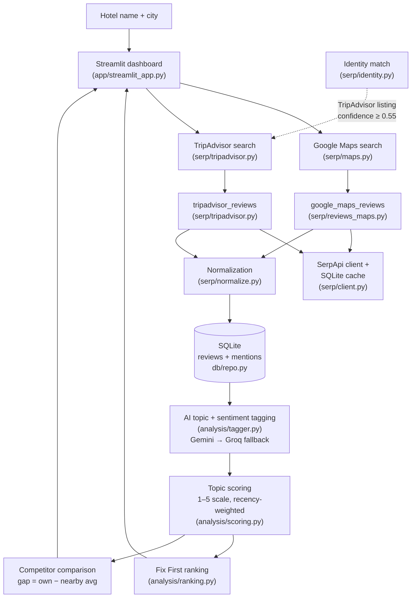
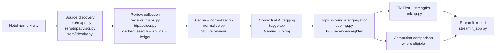
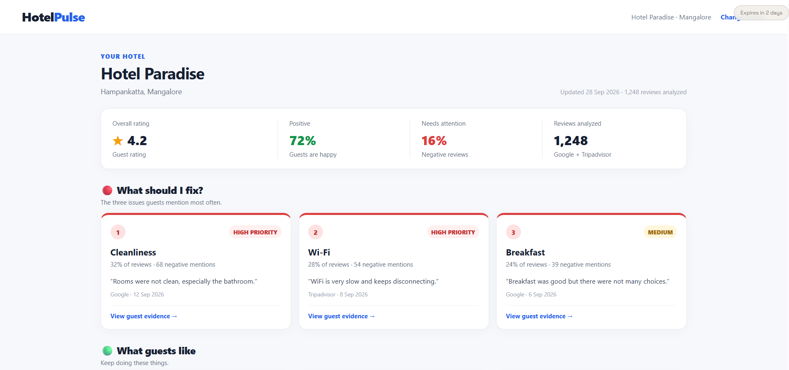
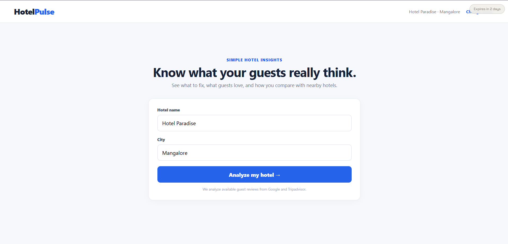

# HotelPulse

**Turn Hotel Reviews Into Actionable Intelligence.**


HotelPulse is a review-intelligence dashboard for independent hotel owners (10–50 rooms, tier-2 and tier-3 Indian cities). It collects available guest reviews from Google Maps and TripAdvisor via SerpApi, uses free LLMs to extract topic-level sentiment across eight canonical service topics, ranks the top three issues to fix first, and compares the hotel's own topic scores against nearby competitors — with every recommendation backed by a verbatim review quote.

> **Hackathon track: Commerce & Market Intelligence.** HotelPulse turns marketplace review data into operational and competitive intelligence a small hotel business can act on. See [Track Fit](#track-fit-commerce--market-intelligence).

---

## Table of Contents

1. [The Problem](#the-problem)
2. [Why Star Ratings and Keyword Searches Fall Short](#why-star-ratings-and-keyword-searches-fall-short)
3. [How HotelPulse Helps](#how-hotelpulse-helps)
4. [Business Value](#business-value)
5. [Core Features](#core-features)
6. [Architecture](#architecture)
7. [From Data to Decision](#from-data-to-decision)
8. [Technology Stack](#technology-stack)
9. [Project Structure](#project-structure)
10. [Prerequisites and Installation](#prerequisites-and-installation)
11. [Environment Variables and Secrets](#environment-variables-and-secrets)
12. [Usage Guide](#usage-guide)
13. [Screenshots](#screenshots)
14. [Testing](#testing)
15. [Privacy, Reliability, and Limitations](#privacy-reliability-and-limitations)
16. [Hackathon Context](#hackathon-context)
17. [Track Fit: Commerce & Market Intelligence](#track-fit-commerce--market-intelligence)
18. [License and Contributions](#license-and-contributions)

---

## The Problem

Independent hotel owners face a daily information problem:

- **Reviews are scattered across platforms** — Google Maps and TripAdvisor each hold a different slice of guest opinion, and the owner must check both.
- **Volume grows faster than reading time.** A 30-room hotel can accumulate hundreds of reviews a year; nobody reads them all systematically.
- **Recurring complaints hide in individual reviews.** One guest mentioning a broken AC is anecdotal; four guests mentioning it in the same month is a pattern the owner cannot always see.
- **"What do I fix first?" has no evidence-based answer.** Without a structured view, owners act on the loudest recent complaint rather than the most damaging recurring one.

Consider a realistic example: the owner of a 25-room independent hotel wants to lift the guest experience before the next busy season and hold their own against three similar hotels nearby. Guest reviews trickle in across Google Maps and TripAdvisor — praise for the food here, a complaint about night-time noise there, a mention of slow WiFi, a grumble about the AC. Each review is read in isolation, if it is read at all. A single angry review about rude staff feels urgent; meanwhile, four quiet mentions of unclean bathrooms spread over two months — the pattern that is actually costing repeat bookings — go unnoticed because nobody reads the reviews systematically. The owner knows their own star rating but has no consistent way to compare cleanliness, staff, food, or value against the hotel down the road, so competitor decisions rest on impression and hearsay.

The business consequences are concrete:

- Important **recurring problems get overlooked** while one-off incidents grab attention.
- Owners **react to the loudest complaint** instead of the most frequent or severe pattern.
- **Positive feedback stays vague** — "guests seem happy" never reveals which strengths (the kitchen? the location? the staff?) must be protected.
- With limited time and budget, **improvements are hard to prioritize**: fix the WiFi, retrain staff, or repaint the rooms?
- **Competitor moves are guesses**, not responses to comparable evidence about where the hotel leads or lags.

This is a small-business problem, not an enterprise one. There is no analytics team — there is an owner with a phone, a dozen tabs open, and twenty minutes between check-in and checkout.

## Why Star Ratings and Keyword Searches Fall Short

Manually reading reviews does not scale, and the shortcuts mislead:

- **Star ratings summarize satisfaction but hide causes.** A hotel can hold a respectable 4.1 average while collecting repeated complaints about one service — the number never says *what* is wrong.
- **Keyword searches miss context.** "The food was not bad" contains the word "bad" but is not a complaint; "The room was clean, but the staff were rude" is positive about cleanliness and negative about staff in a single sentence. A word counter gets both wrong.
- **Averages and word counts cannot separate the isolated from the recurring.** One guest's bad night is anecdote; five guests describing the same failure is a process problem — and only a systematic, per-topic reading of the actual text can tell them apart.

Owners need a way to turn unstructured review text into interpretable, evidence-backed insight: what guests praise, what they repeatedly complain about, what to fix first, and how the hotel compares — each claim traceable to real guest words.

## How HotelPulse Helps

HotelPulse turns the available review data into a structured, evidence-backed action plan:

1. **Collects** available Google Maps and TripAdvisor reviews for the owner's hotel (and nearby competitors), through SerpApi, with aggressive local caching so the same data is never paid for twice.
2. **Analyses** every review with a free LLM (Gemini preferred, Groq fallback) to detect which of the eight canonical topics are mentioned and with what sentiment — in context, not by keyword matching ("not bad" is not negative).
3. **Scores** each topic on a 1–5 scale using a recency-weighted formula, so recent feedback counts more than stale feedback.
4. **Ranks** the top three issues to fix first, each supported by verbatim guest quotes verified as real substrings of the underlying review text.
5. **Compares** the hotel's topic scores against nearby competitors, highlighting where the hotel is ahead and where it lags — with missing data honestly marked, not shown as zero.

The output is a dashboard an owner can act on in under two minutes: *what guests praise, what they complain about, and what to fix first.*

Concretely, the workflow is:

1. **Enter a hotel:** the owner provides a hotel name and city on the landing view and clicks **Analyze my hotel**.
2. **Collect available reviews:** the app discovers the hotel listing and fetches available Google Maps and TripAdvisor reviews through its supported SerpApi integrations — subject to API availability, pagination, and provider limits. It reports only the reviews the supported APIs expose, never every review ever posted.
3. **Analyse review text:** the AI pipeline (`analysis/tagger.py`, Gemini preferred with Groq fallback) reads the full text of each review and assigns per-topic sentiment with contextual understanding — negation, contrast, mixed opinions, synonyms, and Hinglish to the extent the model supports it.
4. **Understand hotel performance:** the dashboard summarizes overall sentiment and per-topic scores on a 1–5 scale (`analysis/scoring.py`), recency-weighted so recent feedback counts more.
5. **Identify what to fix first:** evidence-backed recommendations (`analysis/ranking.py`) surface the most severe recurring complaints.
6. **Understand strengths:** the top-scoring topics show what guests appreciate, so the owner knows what to preserve.
7. **Compare nearby hotels:** when sufficient valid comparable data exists, the dashboard shows topic-level comparisons with signed score gaps; otherwise it says so honestly.
8. **Inspect evidence:** every recommendation links to supporting guest quotations, each validated as a verbatim substring of its original review before display.

## Business Value

HotelPulse supports practical, day-to-day hotel-management decisions. Examples of how its insights can be used:

- **Repeated cleanliness complaints** may indicate a housekeeping process worth reviewing — especially when several reviews cite the same issue.
- **Recurring negative staff feedback** may suggest a need to investigate service consistency across shifts.
- **Positive food feedback** may identify a kitchen strength the hotel should preserve and promote.
- **Valid competitor comparisons** may show an owner where their hotel genuinely leads (e.g. location, value) and where it lags (e.g. WiFi, noise), grounding investment choices in comparable evidence.

These are examples of how the output *can* inform judgment, not conclusions about any specific hotel — and HotelPulse supports human decision-making rather than replacing it. It surfaces evidence-backed patterns; it does not automatically prove a root cause, and acting on its suggestions guarantees no particular business outcome.

---

## Core Features

### Review collection (Google Maps + TripAdvisor)

| Source | SerpApi engine | Status |
|---|---|---|
| Google Maps search + reviews | `google_maps`, `google_maps_reviews` | Implemented, verified against live-captured fixtures. |
| TripAdvisor search + reviews | `tripadvisor`, `tripadvisor_reviews` | Implemented against the published SerpApi docs (offset-based pagination, `limit` ≤ 20/page). **Not yet verified against a live TripAdvisor endpoint.** |

- Reviews are fetched through a single cache-aware client (`serp/client.py`) — every outbound search goes through `cached_search()`, and a cached response costs zero credits.
- Pagination stops at any of: the configured review cap, a page-count guard, an exhausted pagination token, or a page that adds nothing new.
- Duplicates are removed using stable source-specific review IDs.
- All reviews from both sources collapse into one `Review` model, so the analysis pipeline is source-agnostic.

### AI-powered review analysis

- **Provider priority:** Google **Gemini** is used when `GEMINI_API_KEY` is set; **Groq** is the fallback. Set `LLM_PROVIDER=gemini|groq` to force one. No paid models are required.
- **Batching:** reviews are tagged in batches (default 12 per call); reviews already tagged at the current prompt version are never resent — a direct cost saving on re-runs.
- **Quote validation:** every LLM-extracted quote is checked to be a verbatim substring of the raw review text (with whitespace-normalized fallback). Non-verbatim quotes are dropped, never shown.
- **Multilingual handling:** the tagging model is instructed to handle English, Hinglish, and regional-language text *to the extent the model supports it*. Classification accuracy for low-resource languages depends on the underlying model and is not guaranteed. The prompt asks for an English translation field (`quote_en`) alongside the original quote.

### Eight canonical topics

Every mention is assigned to exactly one of eight topics:

1. Cleanliness
2. Staff
3. Food
4. WiFi
5. AC
6. Noise
7. Location
8. Value

Topic analysis turns hundreds of free-text reviews into a compact per-aspect view: what is praised (Staff? Food? Cleanliness?) and what is criticised repeatedly (Noise? Value?). A single review can mention several topics; each contributes evidence only to topics actually present in its text.

### Fix First recommendations

The dashboard highlights the **top three issues** to prioritise, using the ranking logic in `analysis/ranking.py`:

- Only topics with a computed score **below 4.0** are considered.
- Priority is the sum of `severity × recency-weight` over negative and mixed mentions for that topic — so severe, recent complaints climb the ranking.
- Ties are broken by higher negative-mention counts.
- Each recommendation cites real guest quotes, lowest-severity-ordered, drawn from the same reviews that produced the score.

### Nearby-hotel comparison

The comparison table uses the topic scoring formula documented in the project PRD (§11) and implemented in `analysis/scoring.py`:

```
score = 1 + 4 × (positive + 0.5 × mixed) / weighted_total
```

- Scores live on a **1–5 scale** and are clamped to `[1, 5]`. Recency weighting uses a 180-day half-life; a review with no parseable date falls back to a fixed weight of 0.5 (never a guessed date).
- A topic appears in the comparison only when **both** sides have a valid score for that same canonical topic. Invalid values — `None`, `NaN`, ±infinity, or anything outside `[1, 5]` — are rejected outright. A genuine `0.0` is invalid under this formula and is treated as missing data, not as a score.
- The nearby-hotel average is computed from **only the competitors that have a valid score for that topic**. A competitor missing a Cleanliness score contributes nothing to the Cleanliness average (it may still contribute to the Staff average).
- The gap is:

  ```
  Gap = Our Hotel Score − Nearby Hotels Average
  ```

  This is the **raw difference on the 1–5 score scale**, displayed as a signed one-decimal value (`-1.2`, `+0.4`, `0.0`). It is **not** a percentage or percentage-point difference.
- If no valid comparison topic exists, the dashboard shows *"Not enough comparison data yet."* rather than fabricated or zero-filled rows.

### Caching and API budget protection

- **Local SQLite cache:** every successful live search is stored in `api_cache` (one row per unique engine+parameters). A repeat request is served locally at zero credit cost. Only a genuine cache miss triggers a live call.
- **Append-only credit ledger:** budget tracking reads from the `api_calls` table, which appends one row per live call. The cache table is *not* used for credit accounting — one cached query refreshed N times would otherwise under-report spend.
- **Budget guards (verified in code):** before any live call, the client checks credits spent this month against the configured monthly cap (default **250**) and refuses to overspend. The free SerpApi plan also enforces 50 searches per hour; bursts are handled by the page-and-cap discipline in the fetchers rather than an hourly pre-check. Cached data remains fully usable after the quota is exhausted.

### Database and testing

- **SQLite** with WAL journaling, `PRAGMA foreign_keys = ON`, and one thread-local connection per Streamlit script run + short-lived writer sessions, so no `check_same_thread` surprises across Streamlit reruns.
- **228 offline tests** (at the time of writing) covering normalisation, cache behaviour, credit accounting, scoring, ranking, tagger quote validation, contextual sentiment handling (negation, mixed sentiment, multi-topic reviews, synonyms, Hinglish, empty/malformed input, provider failure), pipeline source resilience (one-source success/failure, both-source failure, no extra requests), dashboard view-model construction, TripAdvisor parsing/pagination/identity matching, and comparison eligibility/gap formatting. Tests run fully offline against JSON fixtures and inline payloads; `tests/conftest.py` monkeypatches HTTP libraries so any accidental live call fails loudly.

---

## Architecture



*All SerpApi branches are cache-first: a cache hit short-circuits the live engine call entirely, costing zero credits.*

The pipeline is orchestrated in `services/pipeline.py`: Google Maps is the primary source; TripAdvisor is attempted second and is purely additive — if listing identity is ambiguous or the request fails, a warning is recorded and Maps-only analysis continues. A failure in one source never erases usable data from the other. TripAdvisor reviews are stored under their own TripAdvisor hotel id (preserving source identity and source-aware review ids), but their tagged mentions are merged into the owner's topic scores and sentiment summaries — they shape the report, not just the review count.

---

## From Data to Decision

The same pipeline as a decision workflow — each stage names the component that implements it:



In words: a hotel name and city resolve to platform listings (with conservative cross-source identity matching); available reviews are collected through a cache-first client that records every credit spent; raw responses are normalized into one `Review` model; a free LLM tags each review's topics and sentiments in context; mentions are aggregated into recency-weighted 1–5 topic scores; the ranker turns scores into Fix First priorities and strengths; eligible topics are compared against nearby hotels; and the Streamlit dashboard presents the report with verbatim evidence — or an honest explanation wherever data was insufficient.

---

## Technology Stack

| Technology | Role | Verified details |
|---|---|---|
| **Python** | Runtime | ≥ 3.11 declared in `pyproject.toml`; developed and tested on 3.12/3.14 on Windows. |
| **Streamlit** | Dashboard UI | Custom HTML/CSS components for the landing page, dashboard cards, comparison table, and evidence dialogs. |
| **SerpApi** | Review data (Google Maps + TripAdvisor) | `serpapi` Python SDK 1.1.2; all calls go through one cache-aware wrapper. |
| **SQLite** | Persistence | Stdlib `sqlite3`; caching, hotels, reviews, mentions (`mentions`), tagged-review ledger (`tagged_reviews`), and API-credit ledger (`api_calls`). |
| **Pydantic** | Models + schema validation | v2; review/candidate/topic-score models validate API responses and coerce junk to `None` rather than raising. |
| **Google Gemini (free tier)** | Primary tagging LLM | `google-genai` 2.25.0, default model `gemini-3.1-flash-lite`. |
| **Groq (free tier)** | Fallback tagging LLM | `groq` 1.7.0, default model `llama-3.3-70b-versatile`. |
| **python-dotenv** | Config | `.env` loaded at import time by `hotelpulse.config`. |
| **Pytest** | Testing | 228 offline tests; `conftest.py` also installs a fake SerpApi client and forbids network. |
| **Plotly** | Declared dependency | Present in `pyproject` / `requirements.txt`; no chart currently rendered by the dashboard UI. |

---

## Project Structure

```text
HotelPulse/
├── src/hotelpulse/
│   ├── config.py                  # Env-backed settings (.env loaded here)
│   ├── models.py                  # Pydantic models: Hotel, Review, TopicMention, ...
│   ├── serp/
│   │   ├── client.py              # Cache-aware SerpApi wrapper + budget guard
│   │   ├── maps.py                # Google Maps search (own hotel + nearby)
│   │   ├── reviews_maps.py        # google_maps_reviews, paginated
│   │   ├── tripadvisor.py         # tripadvisor + tripadvisor_reviews, paginated
│   │   ├── identity.py            # Cross-source hotel identity matching
│   │   └── normalize.py           # Raw SerpApi JSON -> Pydantic models
│   ├── db/
│   │   ├── schema.sql             # hotels, reviews, mentions, api_* tables
│   │   ├── connection.py          # Thread-local connections, WAL, FK pragma
│   │   └── repo.py                # Repository helpers (hotels, reviews, cache, ledger)
│   ├── analysis/
│   │   ├── config.py              # PROMPT_VERSION, MIN_MENTIONS, model defaults
│   │   ├── prompts.py             # System + user prompts for the tagger
│   │   ├── llm_client.py          # Gemini → Groq fallback logic
│   │   ├── tagger.py              # Batch tagging + verbatim-quote validation
│   │   ├── scoring.py             # Recency-weighted 1–5 topic scores
│   │   └── ranking.py             # Fix First, strengths, comparison rows
│   ├── services/
│   │   └── pipeline.py            # Search → fetch → tag → score → compare
│   └── app/
│       ├── streamlit_app.py       # Dashboard entry point
│       └── components.py          # Custom HTML/CSS render_* components
├── data/                          # SQLite database (gitignored contents)
├── tests/
│   ├── conftest.py                # Temp DB per test; network blocked
│   ├── fixtures/                  # Real captured SerpApi JSON + fixture README
│   └── test_*.py                  # Normalize, cache, scoring, ranking, tagger,
│                                  # comparison, tripadvisor, pipeline, UI, threads
├── eval/                          # Tagger precision/recall harness + labeled data
├── scripts/capture_fixtures.py    # Helper to capture new SerpApi fixtures
├── PRD.md                         # Full product spec (§9 schema, §11 scoring)
├── agent.md                       # Handoff notes for contributors
└── pyproject.toml / requirements.txt
```

---

## Prerequisites and Installation

### Prerequisites

- **Python 3.11+** (3.12 or 3.14 recommended; developed on Windows).
- A free **SerpApi** account for live review fetches — https://serpapi.com
- One free LLM key: **Gemini** (https://aistudio.google.com/apikey) or **Groq** (https://console.groq.com/keys). Without an LLM key the dashboard still works with previously cached and tagged data.

### Installation

These commands use `py` (Windows Python launcher). On other systems, replace `py` with your `python`/`python3` — a standard virtual environment (`python -m venv .venv`) works fine; using `py` here is a habit from the development machine, not a requirement of the project.

```bash
git clone https://github.com/Team-Project-Space/HotelPulse.git
cd HotelPulse

py -m pip install -r requirements.txt
py -m pip install -e . --no-deps --no-build-isolation

copy .env.example .env      # Windows; use `cp` on Linux/macOS
# now edit .env and add your keys (see next section)
```

Database initialisation happens automatically on first run (`init_db()` is called on analysis); no separate step is required.

### Run

```bash
py -m streamlit run src/hotelpulse/app/streamlit_app.py
```

Open http://localhost:8501 in your browser.

---

## Environment Variables and Secrets

All configuration is via `.env` (loaded at import time by `hotelpulse/config.py`). Copy `.env.example` as a starting point. **Never commit real keys.**

| Variable | Required | Purpose | Fallback |
|---|---|---|---|
| `SERPAPI_API_KEY` | Required for live fetches | SerpApi key for Google Maps + TripAdvisor engines. | Without it, the app raises a clear error on *live* analysis but still serves cached data. |
| `GEMINI_API_KEY` | One of these required | Primary free LLM for topic tagging. | Preferred when both keys are set. |
| `GROQ_API_KEY` | One of these required | Fallback free LLM. | Used only if Gemini is absent or forced via `LLM_PROVIDER=groq`. |
| `LLM_PROVIDER` | Optional | Force `gemini` or `groq`. | Auto-selects Gemini when both keys present. |
| `TAG_MODEL` | Optional | Tagging model override. | `gemini-3.1-flash-lite` (Gemini) / `llama-3.3-70b-versatile` (Groq). |
| `WRITE_MODEL` | Optional | Future reply-drafting model. | `gemini-3.1-flash-lite`. |
| `DB_PATH` | Optional | SQLite file location. | `data/hotelpulse.db`. |
| `MAX_REVIEWS_OWN` | Optional | Per-run review cap for the owner's hotel. | `30`. |
| `MAX_REVIEWS_COMPETITOR` | Optional | Per-run review cap per competitor. | `10`. |
| `SERP_MONTHLY_BUDGET` | Optional | Hard stop on live calls past this many credits/month. | `250`. |
| `SERP_HOURLY_BUDGET` | Optional | Hourly budget value (surfaced in config; per-hour enforcement relies on fetcher caps and SerpApi's own rate limits). | `50`. |
| `MAX_PAGES_OWN` / `MAX_PAGES_COMPETITOR` | Optional | Hard pagination guard regardless of review caps. | `8` / `3`. |

> **Security notice (historical):** earlier commits in this repository's Git history contained live API keys. The current working tree and its history (as of the latest commit) contain no secrets, **but removing a key from the current files does not remove it from past commits.** If you have not already done so: **rotate any SerpApi / Gemini / Groq keys that may ever have been committed** in this repository's history, regardless of whether they appear in the current tree.

---

## Usage Guide

1. **Start the dashboard** — `py -m streamlit run src/hotelpulse/app/streamlit_app.py`, then open http://localhost:8501.
2. **Enter the hotel name and city** on the landing view (defaults: `OYO` / `Bangalore`).
3. Click **"Analyze my hotel"**. The sidebar credit monitor shows how many SerpApi searches your session has used this month.
4. The dashboard header shows the resolved hotel, its address, last-updated date, and number of reviews analysed.
5. **Metrics bar** — average star rating, positive-share %, needs-attention %, and total reviews analysed.
6. **"What should I fix?"** — the top three issues, each with an estimated share of reviews mentioning it and a verbatim sample quote. Click **"View … Evidence"** under a card for more quotes behind that recommendation.
7. **"What guests like"** — the top strengths by topic score.
8. **"What guests talk about"** — mini-cards per topic with the topic score shown as a 0–100 fill.
9. **"How do you compare?"** — the competitor table. Columns: **Topic**, **You**, **Nearby**, **Gap**. The gap is the signed raw 1–5 difference (`-1.2` means you are 1.2 points below the nearby average on that topic). Topics where either side lacks valid data are omitted or shown with an em-dash `—` — a missing score is never rendered as zero. With no comparable topics, the table shows *"Not enough comparison data yet."*
10. **Sidebar** — "Load demo: OYO · Bangalore" replays cached data with no new API calls; the credit monitor shows live usage and cache hits.

Only scores backed by real review evidence (at least `MIN_MENTIONS` = 3 mentions per topic by default) are computed. Topics below that threshold show no score rather than a weak estimate.

---

## Screenshots



*Above: the dashboard view of the current implementation — metrics bar, Fix First cards, strengths, topic grid, competitor comparison, and next actions.*



*Above: the landing view — hotel name + city inputs and the "Analyze my hotel" CTA.*

*(These are design mockups from `playwright/playwright/`, matching the running UI. Live screenshot captures are a TODO for the maintainer.)*

---

## Testing

The suite runs fully offline — no API key, no network. `tests/conftest.py` point every test at a throwaway SQLite database and monkeypatches `requests`/`httpx`/`http.client` to raise, so any accidental live call fails loudly instead of silently burning a credit.

```bash
py -m pytest
```

At the time of writing: **228 passed, 0 failed** (verified on this machine, 2026-10-11). Useful variants:

```bash
py -m pytest tests/test_tripadvisor.py -v    # one file, verbose
py -m pytest -k "comparison or gap"          # filter by test name
py -m pytest --collect-only                  # list tests without running
```

To evaluate the tagging model's precision/recall against a labeled set (uses free LLM tokens when run live):

```bash
py eval/run_eval.py --live
```

Results are written to `eval/results.md`. The labeled set in `eval/labeled_reviews.jsonl` is small (8 reviews) and is a harness sanity check, not a production accuracy claim — treat the numbers accordingly.

---

## Privacy, Reliability, and Limitations

- **Review availability.** HotelPulse sees only what SerpApi's Google Maps and TripAdvisor engines return for a given hotel — bounded by pagination limits, per-request caps, and what the platforms expose publicly. Many reviews (especially older ones or those with restricted visibility) may not be accessible.
- **Identity matching is deliberately conservative.** When the same hotel exists on both Google Maps and TripAdvisor, HotelPulse requires a token-overlap match above a 0.55 confidence threshold and refuses ambiguous ties. When in doubt, it skips the TripAdvisor source rather than risk attaching another hotel's reviews. Resorts or chains with near-identical names in the same city may therefore end up Maps-only.
- **Missing data is shown honestly.** Topics with fewer than 3 valid mentions get no score rather than a weak one. Comparison rows appear only for topics where both sides have valid 1–5 scores; missing competitor data is never zero-filled.
- **AI classification is probabilistic.** Sentiment, topic assignment, and severity come from an LLM, not ground truth. The verified verbatim-quote rule prevents fabricated quotations, but classification errors remain possible — particularly for heavily code-switched Hinglish or low-resource regional languages.
- **Cached analysis can go stale.** Reviews already tagged at the current prompt version are not re-analysed; if a hotel's recent reviews change substantially, a refresh (`Refresh data` equivalent, or a bumped `PROMPT_VERSION`) is needed. Cached data also means newly deleted reviews may linger until refreshed.
- **Credential dependence.** Without a SerpApi key, only cached analysis works. Without any LLM key, no new tagging can occur (cached tags remain usable).
- **Free-plan quotas.** 250 searches/month and 50/hour on SerpApi's free tier — the fetcher caps are tuned to stay well inside this, but a burst can still hit the hourly limit; cached replay keeps the dashboard working regardless.
- **Not a guarantee of business outcomes.** HotelPulse surfaces evidence-based suggestions from available reviews. Acting on "Fix First" advice is the owner's decision; no improvement in ratings or revenue is promised.

---

## Hackathon Context

HotelPulse was built for the **SerpApi Hackathon — Commerce & Market Intelligence track**. SerpApi's Google Maps and TripAdvisor engines make structured public review data accessible in a few lines of Python; HotelPulse layers review normalization, free-LLM topic analysis, recency-weighted scoring, and competitor comparison on top to turn that raw review data into customer-experience and market-position insight a hotel owner can act on.

Public repo: https://github.com/Team-Project-Space/HotelPulse

---

## Track Fit: Commerce & Market Intelligence

HotelPulse belongs in the **Commerce & Market Intelligence** track because it is a decision-support workflow built on marketplace data, not a scraper or a sentiment chart:

- **External marketplace data in:** it collects real customer-review data from Google Maps and TripAdvisor via SerpApi to understand guest expectations.
- **Unstructured text → structured insight:** free-LLM analysis converts free-text reviews into per-topic sentiment, severity-weighted priorities, and 1–5 scores a non-technical owner can read.
- **Operational priorities out:** Fix First recommendations tell a small business where limited time and money should go first, each backed by verbatim guest evidence.
- **Competitor intelligence when the evidence allows:** topic-level comparisons show where the hotel leads or lags nearby rivals — and say plainly when the data cannot support a comparison.
- **API + AI in service of a real decision:** cached, budget-guarded data collection combined with contextual language analysis produces something the owner could not get from star ratings: *what to fix, what to keep, and how you compare.*

No official selection, endorsement, award, or acceptance is claimed — this section describes fit with the track's theme.

---

## License and Contributions

**License:** none currently applied. *(No LICENSE file exists in the repository at the time of writing — the project is therefore not yet formally open-source under any specific license. A maintainer can add one before or after the hackathon.)*

**Contributions:** welcome informally, but there is no formal contributing guide or code-of-conduct yet. To propose a change: fork, create a feature branch, run `py -m pytest` to confirm the offline suite passes, and open a pull request against `main`.

**Details for maintainers:**

- **Handoff documentation:** `agent.md` documents machine-specific gotchas (Windows WDAC restrictions, credit-ledger traps, Streamlit threading) and where each phase of the build stands.
- **Product spec:** `PRD.md` — especially §9 (data models), §11 (scoring formulas), §16 (phase checklist).
- **Fixture capture:** `tests/fixtures/README.md` explains how to capture new real SerpApi fixtures for future regression tests (2–3 credits), and why hand-written fixtures are not used.
- **Screenshot improvements:** replacing the design mockups above with live product screenshots (dashboard, comparison table, evidence modals) is a quick way to strengthen this README. Capture from `py -m streamlit run ...` on a cached-data run to avoid spending credits.
